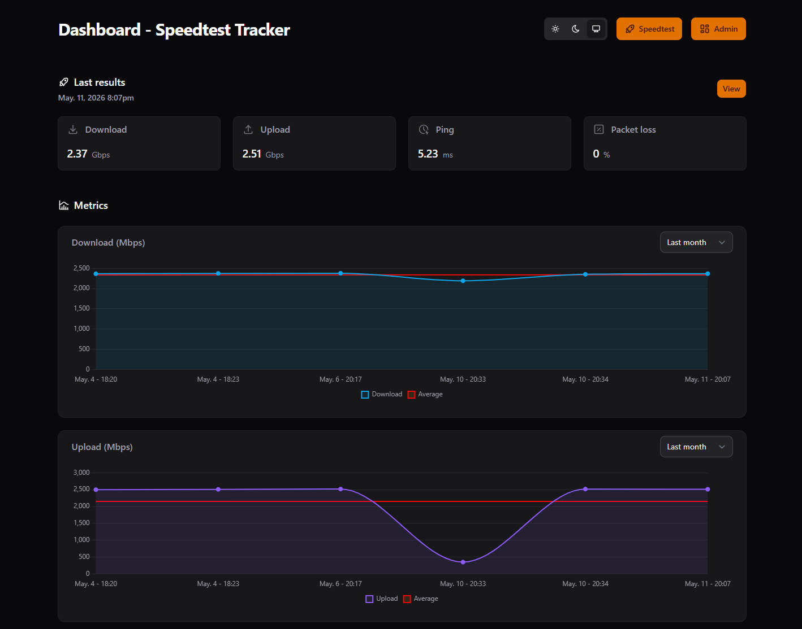

# 🐇 Speedtest Tracker

Speedtest Tracker is a self-hosted application that monitors the performance and uptime of your internet connection.

## Features

- **Automated Tests**: Schedule regular speed tests to monitor your internet connection's performance over time.
- **Detailed Metrics**: Capture download and upload speeds, ping, packet loss and more.
- **Historical Data**: View historical data and trends to identify patterns and issues with your internet connection.
- **Notifications**: Receive notifications when your internet performance drops below a certain threshold.
- **Multi-Language Support**: Available in multiple languages with community translations via [Crowdin](https://crowdin.com/project/speedtest-tracker).

## Alternative speedtest services

Besides Ookla, a speedtest can run against:

| Service | What is measured | Target |
| --- | --- | --- |
| **Cloudflare** | download, upload, latency and latency under load against the nearest Cloudflare edge (speed.cloudflare.com) | — |
| **Yandex Internetometer** | the same against the Yandex CDN nodes picked by yandex.ru/internet | — |
| **iPerf3** | download (reverse run), upload, ICMP ping and packet loss with the `iperf3` CLI | `host` or `host:port` of an iPerf3 server |
| **File download** | download and latency only, by downloading any large file | HTTP(S) URL of the file |

Pick the service in the **Speedtest** dialog. Everything else is managed under **Settings → Speedtests**:

- **Schedules**: any number of scheduled speedtests, each with its own service, cron expression and optional target (Ookla server ID, iPerf3 server or file URL). `SPEEDTEST_SCHEDULE` keeps working next to them.
- **Sources**: iPerf3 servers and file URLs. They are used by schedules without a target and suggested in the Speedtest dialog.
- **Measurement**: test duration and parallel streams for the HTTP services and iPerf3.
- **Default service** of the Speedtest dialog.

These environment variables only provide the initial values of those settings:

| Variable | Default | Description |
| --- | --- | --- |
| `SPEEDTEST_SERVICE` | `ookla` | Service of the `SPEEDTEST_SCHEDULE` schedule and initial default service of the dialog. |
| `SPEEDTEST_IPERF3_SERVERS` | | Comma separated iPerf3 servers (`host[:port]`). |
| `SPEEDTEST_FILE_URLS` | | Comma separated file URLs. |
| `SPEEDTEST_HTTP_DURATION` / `SPEEDTEST_HTTP_STREAMS` | `10` / `4` | Seconds per direction and parallel connections for Cloudflare, Yandex and the file download. |
| `SPEEDTEST_IPERF3_DURATION` / `SPEEDTEST_IPERF3_STREAMS` | `10` / `4` | Seconds per direction and parallel streams for iPerf3. |

## Getting Started

Speedtest Tracker is containerized so you can run it anywhere you run your containers. The image is built by LinuxServer.io, build information can be found [here](https://fleet.linuxserver.io/image?name=linuxserver/speedtest-tracker).

- [Installation](https://docs.speedtest-tracker.dev/getting-started/installation) guide will get you up and running and includes steps for deploying the Docker image or to NAS platforms like Synology and Unraid.
- [Configurations](https://docs.speedtest-tracker.dev/getting-started/environment-variables) are used to tailor Speedtest Tracker to your needs.
- [Notifications](https://docs.speedtest-tracker.dev/settings/notifications) channels alert you when issues happen.
- [Frequently Asked Questions](https://docs.speedtest-tracker.dev/help/faqs) are common questions that can help you resolve issues.

## Translations

Speedtest Tracker supports multiple languages thanks to our community translators!

**Request a new language**: Visit our [Crowdin project](https://crowdin.com/project/speedtest-tracker) and request a new language directly in crowdin.

**Help translate**: Join our [Crowdin project](https://crowdin.com/project/speedtest-tracker) to contribute translations in your language. All translation levels are welcome!
